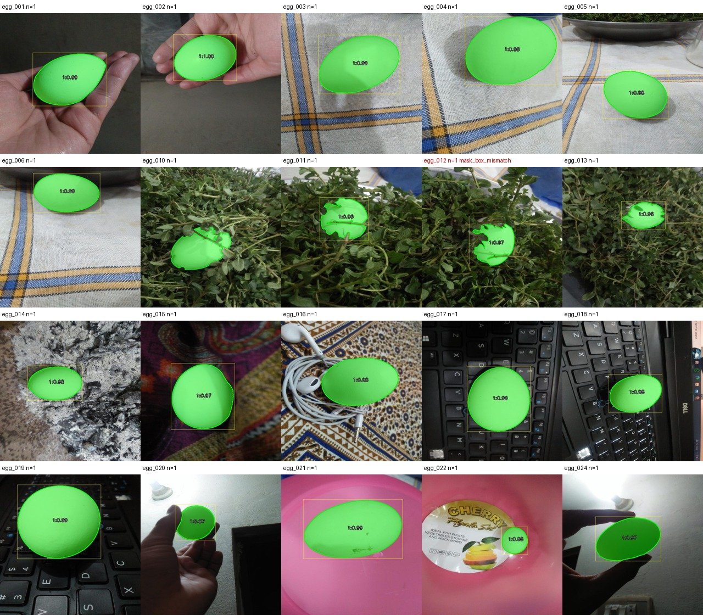

# Task 1 — SAM masks as ground truth

The Roboflow export is folder-format classification: every image sits in `egg/` and there are no boxes or masks. So the masks made here are the ground truth that Tasks 2 and 3 are scored against.

## Method

SAM needs a prompt, and there were no boxes. Grounding DINO (`IDEA-Research/grounding-dino-base`) turns the text prompt `an egg.` into boxes, and SAM ViT-H (`facebook/sam-vit-huge`) segments each box.

Box filtering before SAM:

- DINO box score ≥ 0.30, text score ≥ 0.25
- boxes larger than 70% of the image are dropped (that is the table, not an egg)
- NMS at IoU 0.5
- a box that contains two or more other boxes is a "group of eggs" box and is dropped

After SAM, each mask keeps every connected piece that is at least 10% of the largest piece, and holes are filled. Keeping more than one piece matters: a stem or a tray rod can cut one egg in two, and both halves are egg. Masks under 0.2% of the image are dropped, and when two masks overlap the higher SAM score wins.

The run used a Colab GPU (`task1_colab.ipynb`).

## Review and fixes

Every overlay was checked on the contact sheets in `output/review/`. Flags (`mask_box_mismatch`, `low_sam_score`, etc.) are in red.

| Image | Problem | Fix |
|---|---|---|
| egg_117 | tray rod splits the egg; the first cleanup kept only one half | box + clicks in `fixes.json`, and the cleanup now keeps both pieces |
| egg_010 | plant stem across the egg, far side in shadow; SAM would not include it even with clicks | `refine_masks.py`: polygon over the missing part, adding only eggshell-coloured pixels (HSV S < 60, V > 100), so leaves and the stem stay out |
| egg_042 | looked like a missing sliver beside a rod | zoomed in: the sliver is tray, the mask was already right |
| egg_012 | still flagged `mask_box_mismatch` | leaves cover part of the egg; the mask follows the visible shell, left as is |

The boiling-water images (egg_124, egg_135, egg_145) have foam over the shell, and SAM's outline there is a soft blob. They were kept and this is taken into account in Task 3.

## Result

110 images, 138 eggs (93 images with one egg, 6 with two, 11 with three). 107 prompted by DINO, 3 by hand (`fixes.json`), and egg_010 also polygon-refined (`refinements.json`).

```
output/masks/egg_XXX.png       union mask, 0/255
output/instances/egg_XXX.png   label map, 0 = background, 1..N = egg
output/overlays/egg_XXX.jpg    image + coloured masks + boxes
output/review/sheet_XX.jpg     contact sheets used for the review
output/metadata.jsonl          per image: prompt source, boxes, scores, areas, flags
output/summary.json            totals and flags
```



## Run

```
python task1_sam/run_sam.py --data_dir data/raw --out_dir task1_sam/output --fixes task1_sam/fixes.json
# re-run only the hand-fixed images and merge them in
python task1_sam/run_sam.py --data_dir data/raw --out_dir task1_sam/output --fixes task1_sam/fixes.json --only fixes
# polygon refinement (numpy + Pillow only, runs on CPU)
python task1_sam/refine_masks.py --data_dir data/raw --out_dir task1_sam/output --refinements task1_sam/refinements.json
```
