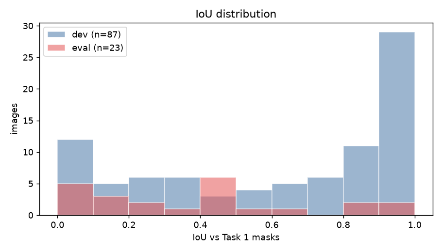
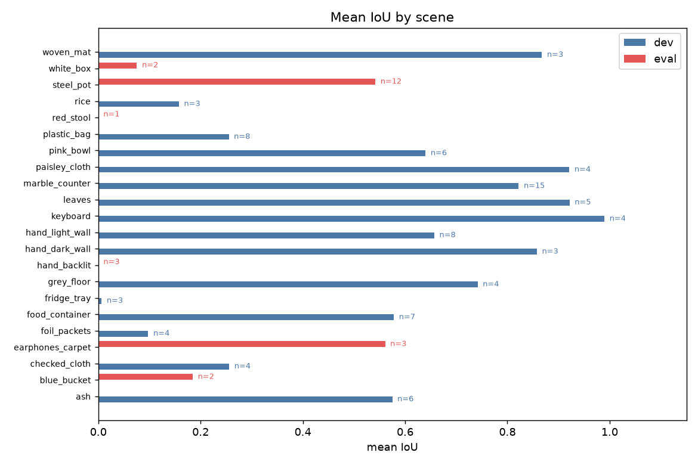
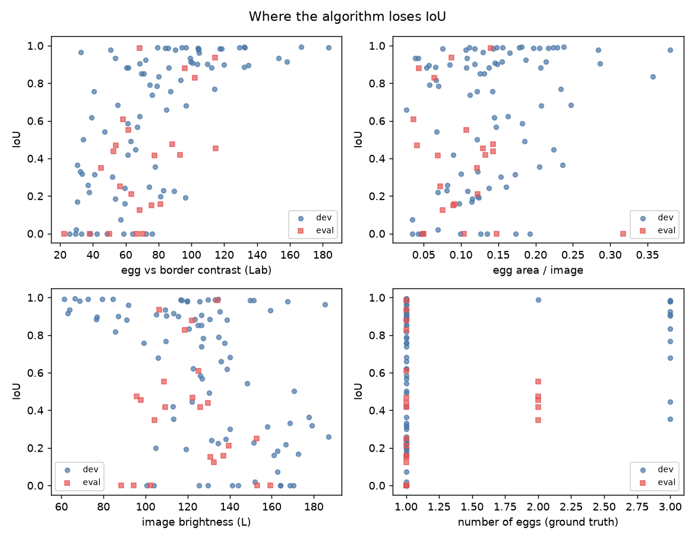
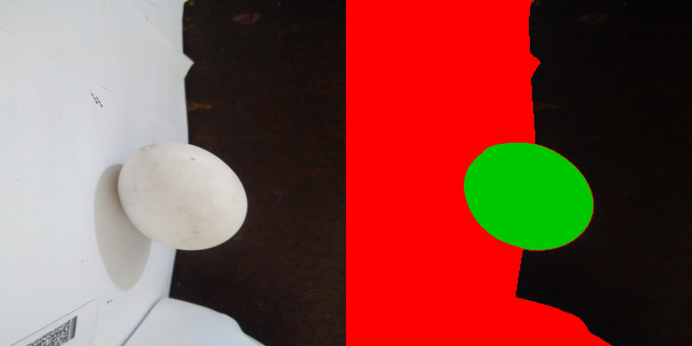
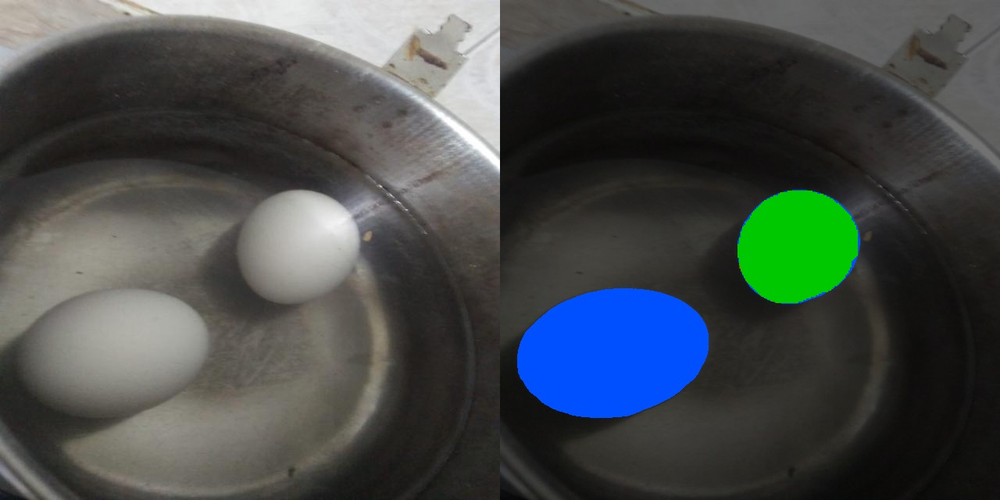
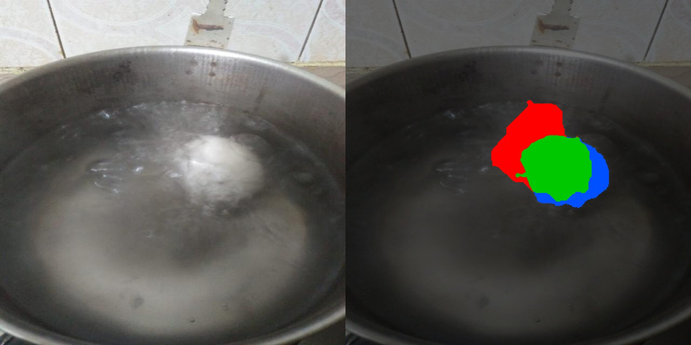
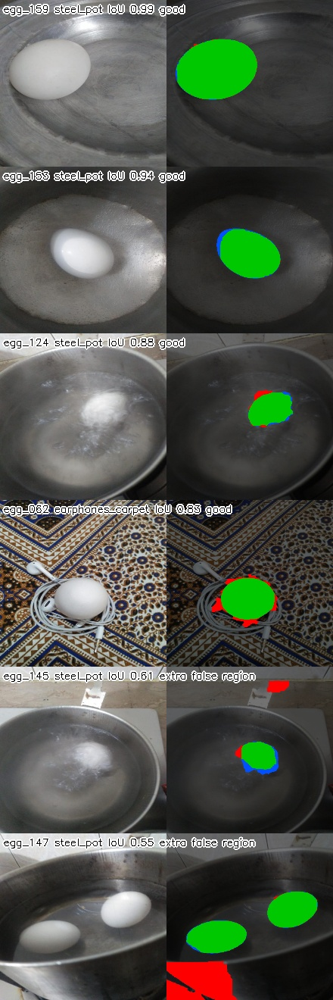

# Task 3: evaluation

The frozen Task 2 algorithm (trial T24) was run once on the eval split. Nothing in the algorithm was changed after looking at these numbers. Predictions are in `../task2_segmentation/predictions/eval/`. Run it with `python task3_evaluation/evaluate.py`. Ground truth is the Task 1 SAM masks. Dev numbers below are the same dev run used while tuning, repeated here for comparison.

Region metrics are IoU, Dice, precision and recall. Boundary metrics are boundary F1 at a 3-pixel tolerance (BF1) and the 95th-percentile Hausdorff distance (HD95, in pixels). Instance metrics are F1 of eggs matched at IoU 0.5, and the absolute error in the egg count. Pixel accuracy is 0.88 on dev and 0.84 on eval, because most pixels are background. IoU is the metric that tracks whether the egg was found.

## Headline numbers

| Metric | Dev mean | Dev median | Dev std | Eval mean | Eval median | Eval std |
|---|---|---|---|---|---|---|
| IoU | 0.612 | 0.758 | 0.359 | 0.379 | 0.417 | 0.307 |
| Dice | 0.684 | 0.862 | 0.345 | 0.478 | 0.588 | 0.327 |
| Precision | 0.718 | 0.988 | 0.389 | 0.543 | 0.560 | 0.420 |
| Recall | 0.761 | 0.920 | 0.336 | 0.605 | 0.742 | 0.391 |
| BF1 (3 px) | 0.545 | 0.575 | 0.335 | 0.417 | 0.466 | 0.262 |
| HD95 (px) | 131 | 66 | 166 | 250 | 217 | 230 |
| Instance F1 @ 0.5 | 0.613 | 1.000 | 0.475 | 0.354 | 0.000 | 0.416 |
| Abs. count error | 0.161 | 0.000 | 0.452 | 0.391 | 0.000 | 0.488 |

Dev is 87 images and 110 eggs (100 predicted). Eval is 23 images and 28 eggs (25 predicted). On dev, 63% of images have IoU at least 0.5 and 53% have IoU at least 0.7. On eval those shares are 26% (6 of 23) and 17% (4 of 23).

HD95 is pulled up by total misses: a prediction that misses the egg is about a full image away from it (the diagonal of a 640×640 image is 905 px). On images where the prediction overlaps the egg at all, mean HD95 is 97 px on dev and 177 px on eval.

Dev is bimodal: a large group above 0.9 and a smaller group at 0. Eval has no such pile at the top. Four eval images clear 0.8 (egg_159 0.99, egg_153 0.94, egg_124 0.88, egg_062 0.83). Five are at 0.00.

## The drop is a scene shift

Whole scenes were assigned to one side, and every eval scene was absent from dev: `hand_backlit`, `white_box`, `red_stool`, `blue_bucket`, `steel_pot`, `earphones_carpet`. The steel pot alone is 12 of the 23 eval images. The gap between 0.61 and 0.38 is that shift.

| Eval scene | Images | Mean IoU |
|---|---|---|
| steel_pot | 12 | 0.54 |
| earphones_carpet | 3 | 0.56 |
| blue_bucket | 2 | 0.19 |
| white_box | 2 | 0.08 |
| hand_backlit | 3 | 0.00 |
| red_stool | 1 | 0.00 |

The same scenes are easy when the egg is a bright blob on a dark or textured background. Dev mean IoU is 0.99 on the keyboard, 0.92 on leaves, 0.92 on the paisley cloth, 0.86 on a hand against a dark wall, and 0.82 on the marble counter (15 images, most of them multi-egg).

IoU rises with egg-versus-border contrast in Lab. Below a contrast of about 40, almost every image fails. Egg size and image brightness do not separate successes from failures on their own. Images with two eggs land in the middle (IoU about 0.4 to 0.6): one egg is found cleanly and the other is missed, so precision stays near 1 while recall falls to about half.

## What goes wrong

Error maps below are the original image beside a colour overlay: green is a true positive, red is a false positive, blue is a false negative. The ten worst eval images are in `figures/worst_eval.jpg`. Per-image numbers are in `results/per_image.csv`.

### 1. A backlit egg is dark, and the algorithm only keeps white blobs

egg_020, egg_024 and egg_044 are a hand holding an egg against a lamp. The egg is a brown silhouette. The whiteness gate (mean white-cue at least 0.5) was chosen because it removed orange lids and blue print on dev. Here it removes the egg. On egg_024 the best candidate in the whole pool has IoU 0.00 with the egg; the selected region is a bright patch of finger. Dev hands were front-lit, so this lighting never appeared during tuning (dev `hand_dark_wall` mean IoU 0.85).

### 2. A large pale surface outranks the egg

The ranking multiplies egg-shape by how much whiter a blob is than its surroundings, then by area to the power 0.25, so a bigger pale region wins ties. On egg_031 (white egg on a red lid, pale tile behind it) there are 120 candidates and one of them covers the egg at IoU 0.38, but it is ranked 56th. The winner covers 65% of the image: the tile wall plus the egg. That blob is then rejected by the area and shape checks, and the output is empty. egg_032 (egg on a white box) fails the same way. egg_030 keeps the box: recall 1.00, precision 0.15, IoU 0.15.

### 3. GrabCut grows into a pale surround

When the egg is found and the surface around it is also pale, GrabCut expands. Recall stays near 1 and precision collapses.

- egg_150 (IoU 0.12): the egg sits on a pale floor tile beside the pot. The mask swallows the tile and stops at the dark pot rim.
- egg_149 (IoU 0.25): same pattern on the pot scene.
- egg_156 and egg_163 (IoU 0.16 and 0.21): the egg is found and the pale blue lid around it is included.

A guarded GrabCut was tried on dev (T16). It raised mean IoU by 0.005 and lowered the median, so it was discarded. These eval leaks are the case it was aimed at, and the dev set did not contain them.

### 4. The dimmer of two eggs in water is dropped

egg_113, egg_114, egg_128 and egg_129 each contain two eggs. Precision is 1.00 and recall is 0.35 to 0.48: the brighter egg is segmented cleanly and the greyer one, sitting deeper in the water, never passes the whiteness gate. Instance count is short by one. Watershed splitting (T20) cannot recover an egg that was never a candidate, and on dev it split highlights on single eggs, so it was discarded.

### 5. Boiling water, where the ground truth is soft

egg_135 (IoU 0.47) and egg_145 (IoU 0.61) are eggs under boiling water. Foam hides the shell. The Task 1 masks are approximate blobs around the foam, which was noted when those masks were reviewed. Part of the red and blue boundary here is SAM's outline, and part is the algorithm following the foam. egg_145 also marks a small bright fitting on the wall as a second egg. egg_124, the same kind of photo with a clearer shell, scores 0.88. egg_147 finds both eggs in the pot (the two green blobs) and adds one false region on the rim, so the count is 3 against 2 and IoU is 0.55.

### 6. Textured cloth is mostly fine

On the earphone carpet, egg_062 scores 0.83. egg_016 and egg_052 score 0.42 and 0.44 with precision 0.99: the mask sits inside the egg and misses the shaded side, including where the cable crosses it.

## Where it already works

On a bright egg against a darker or busier background the mask is close to SAM. The four best eval images are a dry egg in a steel pot (0.99 and 0.94), an egg in water with a visible shell (0.88), and an egg on the carpet (0.83). The same holds on dev for leaves, keyboard, paisley cloth, marble, and a hand against a dark wall.

## What would close the gap

These are the changes the failures point to. They were not applied, because the eval split stays untouched.

1. Let a blob qualify by contrast with its surroundings, so a backlit egg is eligible. The absolute whiteness gate is what deletes egg_020, egg_024, egg_044 and the dimmer egg in the pot.
2. Reject candidates that cover most of the frame before ranking. The tile wall and the white card win because they are large and pale, and `max_area` is 0.65, which is just above them.
3. Limit GrabCut growth into pixels that match the border colour. That is the floor tile, the blue lid, and the pot water.
4. After one egg is accepted, run a second search nearby for another ellipse. Watershed on the accepted mask does not invent the missing egg.

The first three are the same weaknesses the dev log already showed on the fridge tray, the plastic bag, foil packets and rice (dev mean IoU 0.01, 0.18, 0.10 and 0.16). Eval put more of those scenes, plus back-lighting, on the held-out side.
