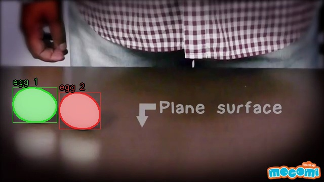
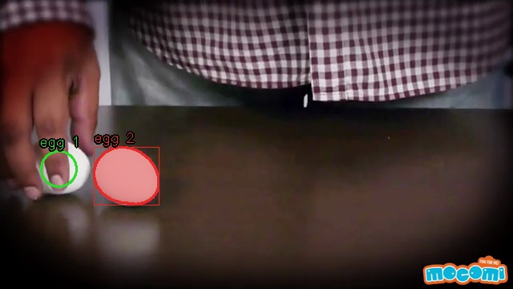
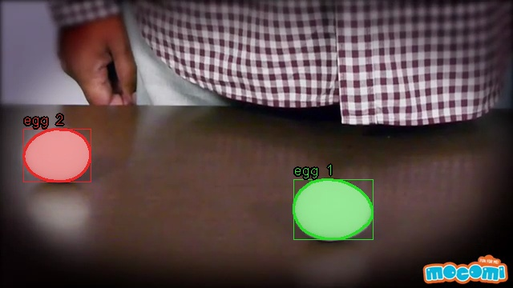

# Task 4 — tracking the two eggs

Video: MocomiKids, “Raw and Boiled Egg Spinning” (`https://www.youtube.com/watch?v=Y4JyV94y2_A`). 640×360, 24 fps, 60 s, 1440 frames. Two white eggs sit on a dark table. A hand picks one up, moves it across the table, and spins it. Green title cards open and close the clip. The eggs touch, a hand hides one of them for several seconds, and the spun egg is motion-blurred.

The still-image algorithm (T24) was not used and was not changed. It takes about 0.8 s per frame, and its whiteness gate was tuned for photographs. This clip needs a detector that runs at video rate and ignores the hands, the table reflections, the on-screen text, and the corner logo.

## Detector

Bright, low-saturation pixels (HSV saturation ≤ 60, value ≥ 165). Skin is removed in YCrCb. The region above the table and the “mocomi” logo are blanked. Components must look like an egg: area 1400–14000 px, solidity ≥ 0.82, aspect ≤ 1.9. When two eggs touch, the blob is split where the distance transform has two peaks.

## Tracker

The clip only ever contains two eggs, so the tracker holds at most two ids.

Each id has a Kalman filter on its centroid. Detections are matched with the Hungarian algorithm; the cost is centroid distance plus mask overlap. A normal match has to land within 90 px. A hand can hide an egg for much longer than that, and the spun egg can come back on the other side of the table, so an unmatched detection is given back to the hidden id instead of starting a third one. A small sliver of shell (under about half the egg’s last area) is not allowed to drag an id.

While an egg is hidden, its id stays at the last place it was seen. The marker is drawn for 1.5 s. The id itself is kept for up to 15 s, which covers the spin. A green title card clears both ids, so the intro and the “why this happens” card are not tracked.

## What the video shows

Exactly two ids are created. Egg 1 starts on the left. The hand picks it up and puts it on the right, and it is still egg 1 after the spin. Egg 2 stays on the left. Of the 1440 frames, 640 show both ids, 142 show one (the other is hidden), and 658 show none (the title cards). No frame shows a third id.

During the fastest part of the spin the moving egg is a blur and is not segmented for about a second. Its id is kept and is reattached as soon as the egg is sharp again. Reflections, the “Plane surface” caption, and the logo are not detected.

## Run

```
bash scripts/download_video.sh
python task4_tracking/track.py
python task4_tracking/track.py --video task4_tracking/input/eggs.mp4 --out task4_tracking/output/tracked.mp4
```

The script writes `output/tracked.mp4` (H.264, original audio) and a frame every 5 s under `frames/`. The video itself is not committed. Tracked output: **https://drive.google.com/file/d/1BbzyooMvdoqHriA8DdoZCqx427-M0TEk/view?usp=sharing**




